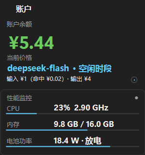
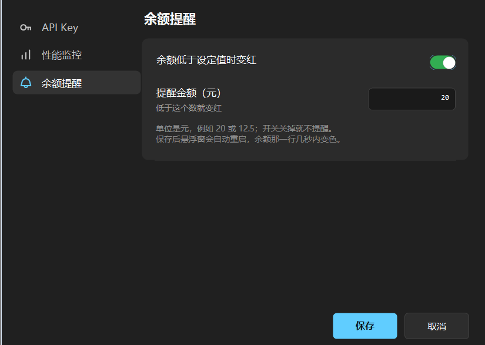
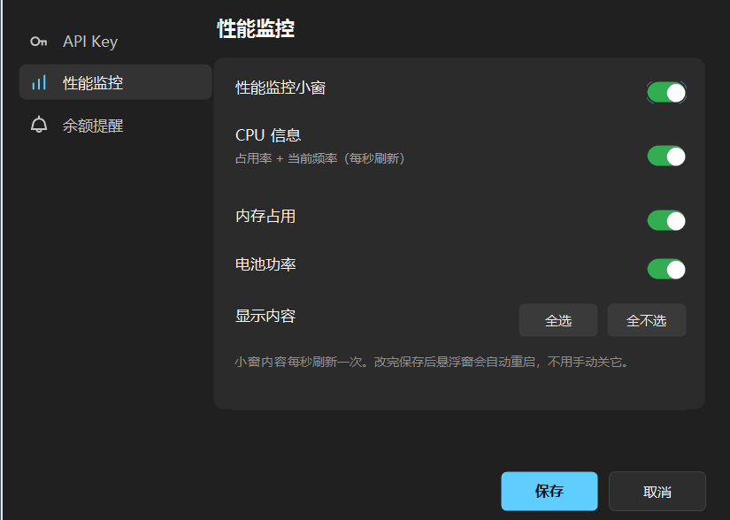
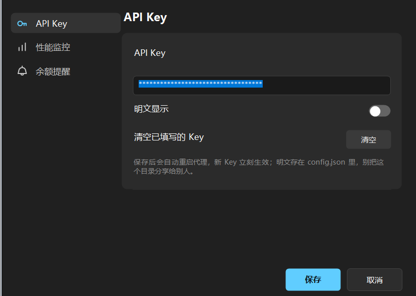

# token-monitor **V1.1.0**

> **导航**：想直接用 → 看下面「三步跑起来」，或下载 [`dist/`](dist/) 里打好的分发包；
> 想改代码 → [开发资料夹说明.md](开发资料夹说明.md)；想深挖细节 → [维护手册.md](维护手册.md)。

一个跑在你自己电脑上的 **token 用量统计代理 + 桌面悬浮窗**：把程序的 `base_url` 指到它，
它就一边把请求原样转发给大模型 API，一边记下每次调用的 token / 花费 / 余额，
并在桌面上用一块置顶小窗实时显示。**只监听本机，零依赖**（不需要 `npm install`）。

> **仓库里有什么**：运行时需要的全部文件都在根目录（`token-monitor.exe`、`widget.ps1`、`proxy.js`、
> `launcher/`、`tools/`、图标与界面预览图），打好的分发包在 [`dist/`](dist/)。
> **刻意没有进仓库的**：`config.json`（里面有明文 API Key）、`data/`（本机运行状态）、
> `备份/`（历史版本）—— 第一次运行程序会自己从 `config.template.json` 生成配置。

```
你的程序 ──► token-monitor 代理(127.0.0.1:8788) ──► 大模型 API
                    ├──► data/usage.jsonl   每次请求明细
                    ├──► /__stats 等接口    实时统计(JSON)
                    └──► 桌面悬浮窗         用量 / 余额 / 价格 / 时段进度
                         └─ 下方性能小窗     CPU / 内存 / 电池功率（可在设置里关掉）
```

## 一、三步跑起来

1. **解压到一个路径里没有中文和空格的地方**（例如 `D:\token-monitor`），双击 `token-monitor.exe`。
   第一次运行 Windows 可能提示"Windows 已保护你的电脑 / 未知发布者"→ 点「更多信息」→「仍要运行」
   （没买代码签名证书，属正常现象）。程序会申请一次管理员权限，点"是"；不想提权点"否"也能用。
2. **第一次会弹「首次使用 · 填写 API Key」**：填你自己的 Key（**只用来查余额**）。
   不想填就留空——等你的程序通过它调用过一次之后，它会自动沿用那次请求带的 Key。
3. **把你自己程序的 `base_url` 改成 `http://127.0.0.1:8788`**，API Key 保持原样，正常调用即可。

```python
# Python（openai SDK）：只改 base_url 这一行
client = OpenAI(api_key="你的key", base_url="http://127.0.0.1:8788/v1")
```

```js
// Node（openai SDK）
const client = new OpenAI({ apiKey: process.env.DEEPSEEK_API_KEY, baseURL: 'http://127.0.0.1:8788/v1' });
```

路径、请求头、请求体都是**原样转发**；API Key 照旧用你自己的，代理不保存、不外发。

关闭：悬浮窗上按 `Esc` 或点右上角 ✕；停掉后台代理双击 `stop.cmd`。
想先看效果又不想花额度：`node proxy.js --mock`（本地伪造响应）+ 另开窗口跑 `node test-client.js`。

## 二、需要什么

- **Windows 10 / 11**（悬浮窗和启动器是 Windows 专用）
- **Node.js**（统计代理需要）
- 可选：想用启动器里的"DSH 网页"按钮，需要全局装过 `@deepseek-ai/dsh`；没装的话那个按钮会自动隐藏，
  统计功能完全不受影响

## 三、界面上的东西



| 位置 | 说明 |
|---|---|
| 右上角胶囊按钮 | 在「账户」与「用量」两页之间切换（当前页会被记住） |
| 账户页 | 账户余额 + 当前价格（**空闲时段蓝色 / 高峰时段红色**）+ **当前时段进度**：还剩多久、已过百分比、右侧进度圆环 |
| 余额变红了 | 说明你在设置里开了「余额提醒」，而且余额已经低于你设的金额（默认是关的，见图） |
| 用量页 | 总 token 用量 + 本轮对话用量（右边的小字是这一轮的花费） |
| 悬浮窗**正下方的小窗** | 性能监控：CPU / 内存 / 电池功率（可在设置里逐项开关，见图） |
| 标题左侧的圆点 | 连接状态灯：绿=能连上本地代理，红=代理没在跑 |
| 拖到屏幕边缘 12px 内松手 | 折叠成贴着边的小标签；**点一下**就展开，折叠状态会被记住 |
| 悬停任意一行 | 该行的明细（单价、时段原因、余额构成、会话 token 明细等）都在悬停提示里 |

- 数字前的 `≈` 表示这些值是**估算**的（上游没返回 usage 时按字符估）。
- **余额和花费都是按当前价估算，不等于账单金额。**
- 右键悬浮窗：切换页面 / 打开网页面板（`http://127.0.0.1:8788/__dashboard`）/ 刷新余额 /
  立即从官网更新价格 / 复位统计 / 折叠 / 退出。
- 右上角齿轮 = **设置**：左边一列导航、右边一张卡片，共三页 ——
  **API Key**（填写 / 明文显示 / 清空）、**性能监控**（总开关 + CPU / 内存 / 电池三项）、
  **余额提醒**（开关 + 一个金额：余额低于该金额时，账户页那个数字变成红色）。
  保存后会按需要自动重启统计代理和悬浮窗，不用手动关它们。







## 四、要注意的

- **别把 `config.json` 发给别人**——里面是**明文**的 API Key（这个包里没有它，第一次运行会自动生成）。
- 这个程序只监听本机（`127.0.0.1`），局域网和外网都连不上它，这是刻意设计。
- 高峰时段 = 北京时间**周一至周五 9:00–12:00、14:00–18:00（不含中国法定节假日）**，
  其余时间（夜间、周末、节假日全天）都按空闲价；节假日表会自动更新，也能在 `config.json` 里手写覆盖。
- 成本只是按 token 数 × 单价估算，**以官方账单为准**。

## 五、想改配置 / 遇到问题

- 改端口、换上游、钉住某个模型的价格、关掉价格自动更新……都在 `config.json` 里，字段说明见
  `config.template.json` 的注释和作者手册的第一、四、五节。
- 代理在线状态：浏览器打开 <http://127.0.0.1:8788/__health>；统计快照：<http://127.0.0.1:8788/__stats>。
- 端口被占用 → 改 `config.json` 的 `port`，或双击 `stop.cmd` 停掉旧进程。
- 价格显示"未收录" → 该模型不在内置价表里，在 `config.json` 的 `pricing` 里补一行即可。

> 这份说明只覆盖"怎么用"。想改代码看 `开发资料夹说明.md`（文件清单与编码铁律），
> 要深挖接口表、配置项、统计口径和踩坑记录看 `维护手册.md`。
